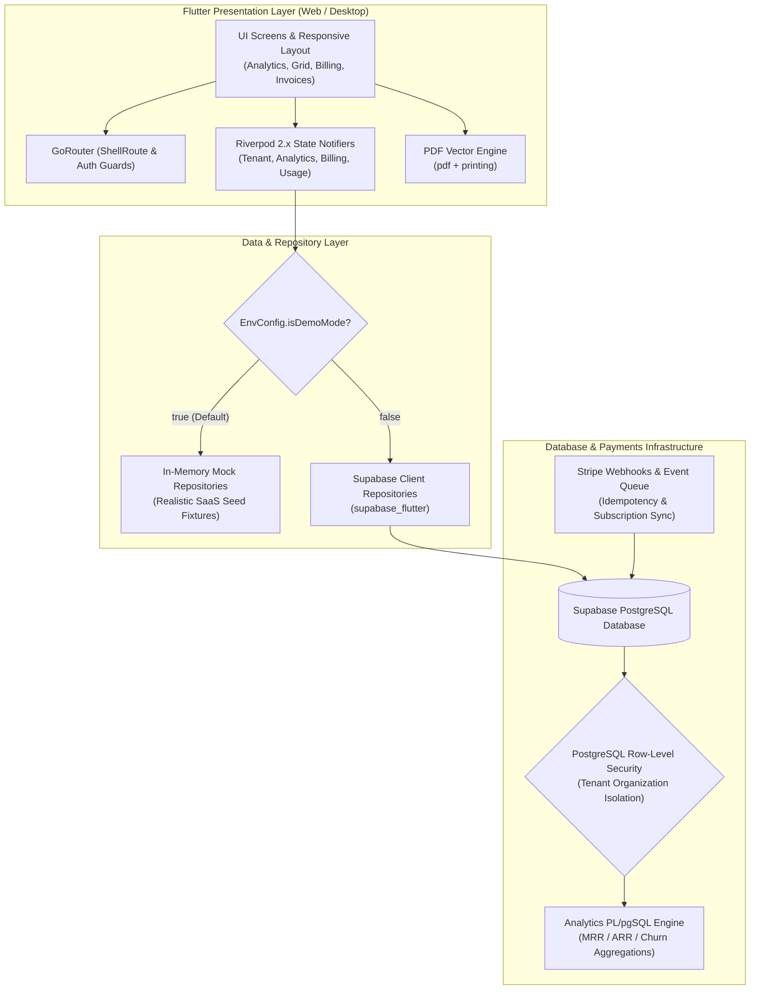

# ChromaMetrics ⚡
### Enterprise Multi-Tenant SaaS Billing & Real-Time Analytics Dashboard

[](https://flutter.dev)
[](https://dart.dev)
[](https://riverpod.dev)
[](https://supabase.com)
[](LICENSE)
[]()


**ChromaMetrics** is a production-grade, multi-tenant B2B SaaS Billing and Analytics portal engineered with **Flutter Web & Desktop**, **Riverpod 2.x**, and **Supabase (PostgreSQL with strict Row-Level Security)**. 

It provides SaaS founders, operations leads, and billing teams with real-time insight into subscription health, recurring revenue (MRR/ARR), customer churn, metered API/storage usage, tiered plan management, and in-browser vector PDF invoice generation.

---

## 🌟 Key System Capabilities

- 🏢 **Multi-Tenant Isolation & Live Switching**:
  - Secure tenant separation via PostgreSQL Row-Level Security (RLS) policies.
  - Interactive organization selector in the top navigation bar to seamlessly hot-swap between active workspaces (e.g., *Acme Corp* vs. *Starlight AI*).
  - Built-in Role-Based Access Control (RBAC): `Owner`, `Admin`, `Billing Manager`, `Member`, and `Viewer`.

- 📈 **Executive Analytics & Real-Time Visualizations**:
  - **MRR / ARR Metric Cards**: Live financial health indicators with trend badges and period-over-period delta percentages.
  - **Interactive Revenue Curves (`fl_chart`)**: Smooth Bézier gradient line charts with dynamic cursor hover tooltips and monthly revenue projections.
  - **Churn Rate Gauge (`fl_chart`)**: Radial donut visualization tracking subscriber retention vs. monthly churn.
  - **Unit Economics**: Automatic calculation of ARPU (Average Revenue Per User) and LTV (Lifetime Value).

- ⚡ **High-Performance Customer Usage Data Grid (`pluto_grid`)**:
  - High-throughput virtualized data table designed to render thousands of customer usage records without frame drops.
  - Column reordering, resizing, sorting, text search, and status filtering.
  - One-click **Export to CSV** utility for accounting and audit reconciliation.

- 💳 **Tiered Subscription & Plan Management**:
  - Modular tier comparison cards (*Starter*, *Pro*, *Enterprise*).
  - Stripe-ready billing structure with billing frequency toggling (`Monthly` / `Annual`), seat limits, and metered quota display.
  - Interactive plan upgrade and downgrade state transitions.

- 📄 **In-Browser Vector PDF Invoicing (`pdf` + `printing`)**:
  - 100% client-side vector PDF invoice compilation — zero backend rendering dependencies.
  - Embedded modern typographic invoice layouts with line items, tax breakdowns, company metadata, and status badges.
  - Interactive browser print-preview modal with one-click direct printing and PDF download.

- 🚀 **Zero-Config Instant Demo Mode**:
  - Operates out-of-the box in zero-config Demo Mode using in-memory mock repositories and realistic SaaS fixtures.
  - Switch to a live Supabase backend by simply toggling `EnvConfig.isDemoMode = false` and adding your project credentials.

---

## 🛠️ System Tools & Technology Stack

### Frontend & Application Layer

| Technology / Tool | Version | Purpose & Architectural Justification |
| :--- | :--- | :--- |
| **[Flutter Web & Desktop](https://flutter.dev)** | `3.47+` | Cross-platform UI toolkit sharing identical dashboard logic and responsive layouts across Web, macOS, Windows, and Linux. |
| **[Dart SDK](https://dart.dev)** | `3.13+` | Sound null safety, pattern matching, switch expressions, and compiled WebAssembly / JavaScript execution. |
| **[flutter_riverpod](https://pub.dev/packages/flutter_riverpod)** | `^2.5.1` | Compile-time safe, testable dependency injection and state management using `StateNotifierProvider` and `FutureProvider`. |
| **[go_router](https://pub.dev/packages/go_router)** | `^14.2.0` | Declarative routing with URL synchronization, nested `ShellRoute` navigation layouts, and automated authentication redirect guards. |
| **[fl_chart](https://pub.dev/packages/fl_chart)** | `^0.68.0` | High-performance, hardware-accelerated 2D charting library for rendering interactive MRR line charts and retention donut gauges. |
| **[pluto_grid](https://pub.dev/packages/pluto_grid)** | `^8.0.0` | Enterprise-grade virtualized datagrid supporting pagination, keyboard navigation, sorting, and inline filtering. |
| **[pdf](https://pub.dev/packages/pdf)** | `^3.10.8` | Low-level vector PDF document creation engine for generating structured, print-ready invoices. |
| **[printing](https://pub.dev/packages/printing)** | `^5.13.2` | Native platform print bridge providing browser-native print preview dialogs and document export. |
| **[google_fonts](https://pub.dev/packages/google_fonts)** | `^6.2.1` | Typography system loading clean, modern fonts (*Inter* & *JetBrains Mono* for tabular numeric data). |
| **[intl](https://pub.dev/packages/intl)** | `^0.19.0` | Number, currency, and date formatting adhering to international standards. |
| **[csv](https://pub.dev/packages/csv)** | `^6.0.0` | Bidirectional CSV parsing and serialization for datagrid export workflows. |
| **[universal_html](https://pub.dev/packages/universal_html)** | `^2.2.4` | Cross-platform abstraction for browser DOM elements (triggering blob file downloads on Flutter Web). |

---

### Backend, Security & Database Layer

| Technology / Tool | Purpose & Architectural Justification |
| :--- | :--- |
| **[Supabase](https://supabase.com)** | Open-source backend providing instant PostgreSQL APIs, real-time change streams, and managed authentication. |
| **[PostgreSQL 15+](https://www.postgresql.org)** | Relational data persistence, foreign key constraints, UUID generation (`uuid-ossp`, `pgcrypto`), and atomic transactions. |
| **PostgreSQL Row-Level Security (RLS)** | Kernel-level data isolation ensuring tenants can only access records where `organization_id` matches their authenticated session. |
| **PostgreSQL PL/pgSQL Functions** | Server-side aggregation for MRR, ARR, and churn calculations (`get_saas_metrics()`, `get_monthly_revenue_trend()`). |
| **Stripe Webhook Architecture** | Idempotent event logging (`stripe_events`) and subscription status mapping (`active`, `past_due`, `canceled`, `trialing`). |

---

## 🏛️ System Architecture & Data Flow



---

## 🔒 Multi-Tenant Data Isolation (PostgreSQL RLS)

Every table storing tenant-specific data contains an `organization_id` foreign key. Row-Level Security (RLS) is enabled globally. 

A database security helper identifies the authenticated user's organization and permissions:

```sql
-- Helper function to inspect caller membership
CREATE OR REPLACE FUNCTION current_user_tenant_role(org_id UUID)
RETURNS tenant_role AS $$
  SELECT role FROM organization_memberships
  WHERE organization_id = org_id
    AND user_id = auth.uid()
  LIMIT 1;
$$ LANGUAGE sql STABLE SECURITY DEFINER;
```

Tenant policies ensure complete multi-tenant boundaries:

```sql
-- Invoices table RLS Policy
CREATE POLICY "Tenant members can view their organization invoices"
  ON invoices FOR SELECT
  USING (
    organization_id IN (
      SELECT organization_id FROM organization_memberships WHERE user_id = auth.uid()
    )
  );

CREATE POLICY "Tenant billing managers can manage invoices"
  ON invoices FOR ALL
  USING (
    current_user_tenant_role(organization_id) IN ('owner', 'admin', 'billing_manager')
  );
```

---

## 📂 Project Directory Structure

The project follows a clean **Feature-First Layered Architecture**:

```
Multi-Tenant SaaS Billing & Analytics/
├── .vscode/
│   └── launch.json                # VS Code launch configs (Chrome, Edge, Windows Desktop)
├── assets/
│   └── images/                    # Brand assets, logos, and illustration placeholders
├── lib/
│   ├── main.dart                  # Application bootstrap & ProviderScope initialization
│   ├── core/                      # Shared infrastructure across all features
│   │   ├── config/
│   │   │   └── env_config.dart    # Environment variables (Demo mode toggle, Supabase URLs)
│   │   ├── router/
│   │   │   ├── app_router.dart    # GoRouter definitions, navigation shell & route guards
│   │   │   └── app_routes.dart    # Strongly-typed route constants
│   │   ├── theme/
│   │   │   ├── app_colors.dart    # Modern dark/light Slate & Indigo palette
│   │   │   ├── app_theme.dart     # Material 3 ThemeData & CardTheme configurations
│   │   │   └── app_typography.dart# Responsive text scale & Google Fonts styling
│   │   ├── utils/
│   │   │   ├── csv_exporter.dart  # Client-side CSV generation & Web Blob download
│   │   │   ├── currency_formatter.dart # Cents and compact currency formatters
│   │   │   └── date_formatter.dart# Standardized date & month/year formatting
│   │   └── widgets/
│   │       ├── metric_card.dart   # Metric card with delta pill & icon badge
│   │       ├── responsive_scaffold.dart # Adaptive scaffold with collapsable sidebar
│   │       ├── sidebar_navigation.dart # Side nav rail with active route highlighting
│   │       ├── status_badge.dart  # Multi-color status badges (PAID, TRIAL, CANCELED)
│   │       └── top_nav_bar.dart   # Header with Tenant Organization Switcher
│   └── features/                  # Domain-driven feature modules
│       ├── analytics/             # Executive KPI & Revenue Visualization
│       │   ├── data/              # Analytics repositories (Mock + Supabase RPC)
│       │   ├── domain/            # SaasMetrics & RevenueTrendPoint models
│       │   └── presentation/      # fl_chart MRR LineChart & Churn Donut Gauge
│       ├── auth/                  # Authentication & Session Management
│       │   ├── data/              # Auth repository (Mock + Supabase Auth)
│       │   ├── domain/            # AppAuthState & User entities
│       │   └── presentation/      # LoginScreen & Authentication controller
│       ├── billing/               # Subscription & Tier Management
│       │   ├── data/              # Billing repository & Stripe Price synchronization
│       │   ├── domain/            # SubscriptionPlan, Subscription & Invoice models
│       │   └── presentation/      # PlanTierCard & SubscriptionManagementScreen
│       ├── invoicing/             # Invoicing & Vector PDF Generation
│       │   ├── presentation/      # InvoiceHistoryScreen with filterable table
│       │   └── services/          # PdfInvoiceGenerator vector document builder
│       ├── tenant/                # Multi-Tenancy & Organization Management
│       │   ├── data/              # Tenant repository & membership queries
│       │   ├── domain/            # Tenant & TenantMembership models with RBAC logic
│       │   └── presentation/      # TenantController & organization switcher dropdown
│       └── usage_grid/            # Customer Usage Metering Table
│           ├── data/              # Usage repository & customer consumption logs
│           ├── domain/            # CustomerUsage entity
│           └── presentation/      # PlutoGrid table screen with search & CSV export
├── supabase/
│   ├── schema.sql                 # Complete Postgres DDL, RLS policies, tables & functions
│   └── seed.sql                   # Realistic multi-tenant mock organizations & subscriptions
├── test/                          # Comprehensive Automated Test Suite
│   ├── core/
│   │   └── formatters_test.dart   # Currency and date formatter unit tests
│   ├── features/
│   │   ├── analytics/saas_metrics_test.dart # ARPU, ARR, LTV calculation tests
│   │   ├── billing/billing_models_test.dart # Subscription & invoice mapping tests
│   │   └── tenant/tenant_test.dart          # Tenant JSON and RBAC role unit tests
│   └── widgets/
│       ├── metric_card_test.dart  # MetricCard widget rendering & trend tests
│       └── status_badge_test.dart # StatusBadge color & label widget tests
├── web/
│   ├── index.html                 # Modern Flutter 3.22+ bootstrap entrypoint
│   └── manifest.json              # Web app progressive manifest
└── pubspec.yaml                   # Dependency definitions & asset configuration
```

---

## 🚀 Getting Started

### 1. Prerequisites
- **Flutter SDK**: `3.22+` (Stable branch). Check via `flutter --version`.
- **Dart SDK**: `3.4+` (Included with Flutter).
- **Google Chrome** or **Microsoft Edge** for Web debugging.
- **VS Code** with Flutter and Dart extensions installed.

### 2. Quick Run (Instant Demo Mode)
The application is pre-configured with `EnvConfig.isDemoMode = true`, meaning you can run it immediately without setting up any cloud backend or API keys:

1. Open the project in VS Code:
   ```bash
   cd "Multi-Tenant SaaS Billing & Analytics"
   ```
2. Fetch dependencies:
   ```bash
   flutter pub get
   ```
3. Run on Chrome:
   ```bash
   flutter run -d chrome
   ```
   *(Or press `F5` in VS Code to launch with hot-reload enabled)*.

### 3. Connecting to Live Supabase (Production Mode)

1. Create a new project on [Supabase.com](https://supabase.com).
2. Open the **SQL Editor** in your Supabase dashboard:
   - Copy the contents of [`supabase/schema.sql`](supabase/schema.sql) and run it.
   - Copy the contents of [`supabase/seed.sql`](supabase/seed.sql) and run it to populate sample data.
3. Update [`lib/core/config/env_config.dart`](lib/core/config/env_config.dart):
   ```dart
   class EnvConfig {
     static const bool isDemoMode = false; // Toggle to false for live backend
     static const String supabaseUrl = 'https://YOUR_PROJECT_ID.supabase.co';
     static const String supabaseAnonKey = 'YOUR_SUPABASE_ANON_KEY';
   }
   ```
4. Restart the app. It will now connect directly to your live PostgreSQL database with full RLS!

---

## 🧪 Testing & Code Quality

The codebase enforces strict linting and includes automated unit and widget test coverage:

- **Run all automated tests**:
  ```bash
  flutter test
  ```
  *(Verifies all 38 unit and widget tests covering domain models, formatters, configurations, telemetry, and widgets)*.

- **Run static code analysis**:
  ```bash
  flutter analyze
  ```
  *(Ensures 0 errors and 0 warnings against `package:flutter_lints` rules)*.

- **Compile for production web release**:
  ```bash
  flutter build web --release
  ```

---

## 📚 Documentation & Community

- [Contributing Guidelines](CONTRIBUTING.md)
- [Code of Conduct](CODE_OF_CONDUCT.md)
- [Security Policy](SECURITY.md)
- [Multi-Tenant JWT Security & Token Claims](docs/SECURITY_JWT.md)
- [Production Web Deployment Guide](docs/DEPLOYMENT_GUIDE.md)
- [API Telemetry Ingestion Spec](docs/API_INTEGRATION.md)
- [Architecture Decision Records (ADRs)](docs/adr/)
- [Database Schema & RLS Policies](docs/DATABASE_SCHEMA.md)
- [Release Changelog](CHANGELOG.md)

---

## 📄 License

This project is licensed under the [MIT License](LICENSE).


